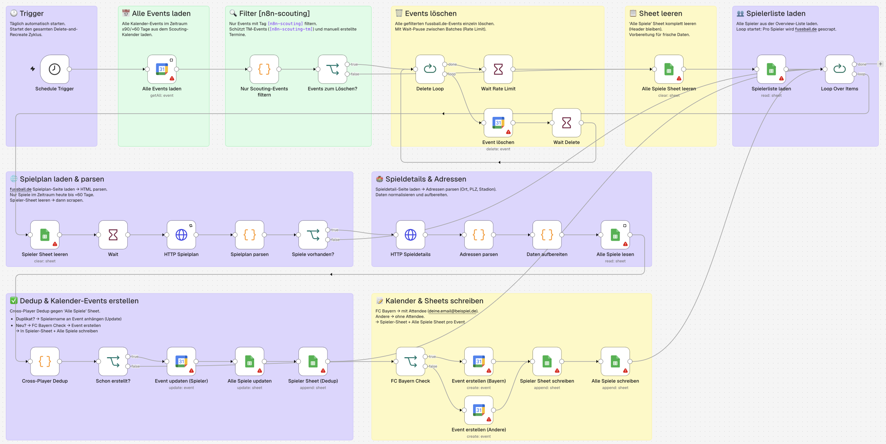

# Scouting Kalender Fussball.de

Automatisierter Spielkalender für Fußball-Scouting: Liest Spielerlisten aus Google Sheets, scraped deren Spielpläne von Fussball.de und erstellt Google Calendar Events — inklusive Deduplizierung und Rate Limiting.

## Was macht der Workflow?

1. **Trigger:** Läuft nach Schedule (zeitgesteuert)
2. **Cleanup:** Bestehende Scouting-Events werden aus dem Google Calendar gelöscht, das Tracking-Sheet wird geleert
3. **Spielerliste laden:** Spieler werden aus einem Google Sheet gelesen
4. **Scraping (Loop):** Für jeden Spieler wird der Spielplan von Fussball.de per HTTP Request abgerufen
5. **Parsing:** Spielplan-HTML wird mit JavaScript-Code geparst, Adressen extrahiert und Daten aufbereitet
6. **Deduplizierung:** Cross-Player Dedup stellt sicher, dass ein Spiel mit mehreren Scout-Spielern nur einmal als Event erscheint (mit allen Spielernamen im Event)
7. **Calendar Events:** Neue Spiele werden als Google Calendar Events erstellt (mit farblicher Unterscheidung z.B. für FC Bayern), bestehende Events werden aktualisiert
8. **Tracking:** Alle Spiele werden in Google Sheets dokumentiert

## Genutzte Nodes & Integrationen

- **Schedule Trigger** — Zeitgesteuerte Ausführung
- **Google Calendar (4x)** — Events lesen, löschen, erstellen, updaten
- **Google Sheets (6x)** — Spielerlisten, Tracking, Dedup-Daten
- **HTTP Request (2x)** — Scraping von Fussball.de (Spielplan + Spieldetails)
- **Code (5x)** — JavaScript für HTML-Parsing, Adress-Extraktion, Datenaufbereitung, Cross-Player-Deduplizierung
- **Split In Batches + Wait** — Rate Limiting gegen API-Limits

## Besonderheiten

- Mein komplexester Workflow (40 Nodes, 30 Connections)
- Vollständiges CRUD: Events werden nicht nur erstellt, sondern auch aktualisiert und gelöscht
- Intelligente Deduplizierung über mehrere Spieler hinweg
- Rate Limiting mit Wait-Nodes, um API-Limits einzuhalten
- Farbcodierung der Events nach Verein

## Nodes

40 (davon 5 Code-Nodes mit eigenem JavaScript)

